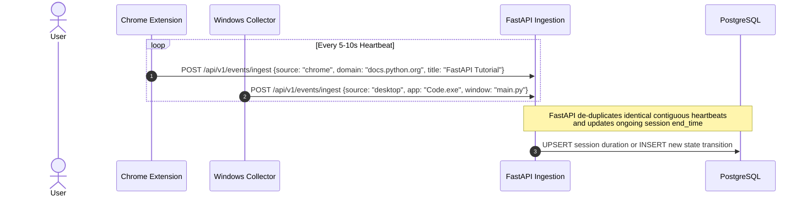
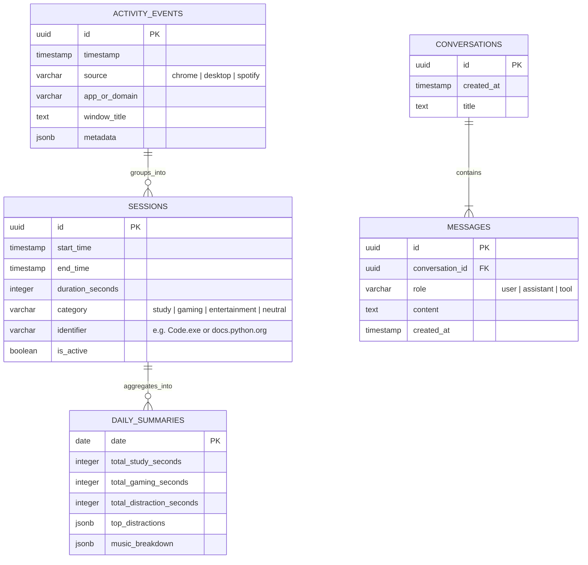
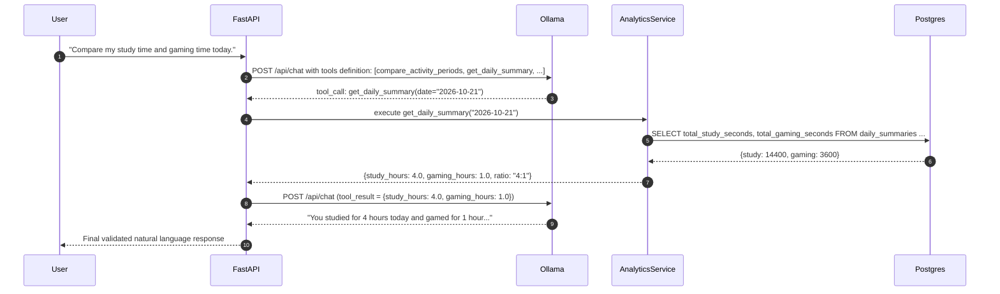

# Personal Activity Analytics & Local AI Assistant — System Architecture

A local-first, privacy-focused activity intelligence platform combining automated multi-source telemetry collection, deterministic SQL analytics, and local LLM tool calling via Ollama on an RTX 3050 laptop GPU.

---

## 1. High-Level Architecture Diagram

```mermaid
flowchart TB
    subgraph DataCollectors["1. Telemetry Collectors"]
        Chrome["Chrome Extension<br/>(Active tab, URL domain, study session tags)"]
        WinWatcher["Windows Desktop Collector<br/>(Active window title, process name, game exe)"]
        SpotifySync["Spotify Background Sync<br/>(Current track, artist, play/pause state)"]
    end

    subgraph CoreBackend["2. FastAPI Core Engine (127.0.0.1:8000)"]
        IngestionRouter["Ingestion Router<br/>/api/v1/events/ingest"]
        EventProcessor["Session Normalizer & Duration Engine"]
        AnalyticsService["Deterministic Analytics Service<br/>(Calculates totals, ratios, comparisons)"]
        ToolRegistry["AI Tool Registry<br/>(Predefined Python analytical functions)"]
        AIRouter["Assistant Router<br/>/api/v1/assistant/*"]
    end

    subgraph StorageLayer["3. Local Storage (127.0.0.1:5432)"]
        Postgres[(PostgreSQL 16)]
        RawEvents["raw_activity_events"]
        Sessions["processed_sessions"]
        DailyAggs["daily_category_aggregates"]
        Conversations["chat_conversations & messages"]
        Postgres --- RawEvents
        Postgres --- Sessions
        Postgres --- DailyAggs
        Postgres --- Conversations
    end

    subgraph ModelRuntime["4. Local AI Runtime (127.0.0.1:11434)"]
        Ollama["Ollama Server"]
        Model["Quantized Model<br/>(Qwen2.5:7b-instruct-q4 or Llama-3.2:3b)"]
        Ollama --- Model
    end

    subgraph ClientUI["5. User Presentation"]
        Dashboard["Local Web Dashboard<br/>(Timeline, Charts, Activity Breakdown)"]
        ChatInterface["Assistant Chat UI<br/>(Conversational query interface)"]
    end

    %% Ingestion flows
    Chrome -->|POST /events/chrome| IngestionRouter
    WinWatcher -->|POST /events/desktop| IngestionRouter
    SpotifySync -->|POST /events/spotify| IngestionRouter
    IngestionRouter --> EventProcessor
    EventProcessor --> Postgres

    %% Query & Analytics flows
    Dashboard -->|GET /analytics/*| AnalyticsService
    AnalyticsService --> Postgres

    %% AI Query & Tool Calling flow
    ChatInterface -->|POST /assistant/chat| AIRouter
    AIRouter -->|1. Prompt + Tools Schema| Ollama
    Ollama -->|2. Tool Call Request (Function + Args)| AIRouter
    AIRouter -->|3. Execute Function with Args| ToolRegistry
    ToolRegistry --> AnalyticsService
    AIRouter -->|4. Return Tool Results| Ollama
    Ollama -->|5. Grounded Natural Language Response| AIRouter
    AIRouter --> ChatInterface
```

---

## 2. Hardware Allocation & Model Sizing (RTX 3050 Laptop)

> [!NOTE]
> The NVIDIA RTX 3050 Laptop GPU typically comes with **4 GB** or **6 GB** of GDDR6 VRAM and shares system RAM via unified host-to-device transfers. Model selection must prioritize fitting entirely within VRAM for interactive generation speeds (> 25 tokens/sec).

| Model Candidate | Parameter Count | Quantization | VRAM Footprint | Tool Calling Reliability | Suitability |
| :--- | :--- | :--- | :--- | :--- | :--- |
| **Qwen 2.5 7B Instruct** | 7.6B | `q4_K_M` | ~4.7 GB | ⭐⭐⭐⭐⭐ (Excellent) | Best for 6 GB VRAM models |
| **Llama 3.2 3B Instruct** | 3.2B | `q4_K_M` | ~2.2 GB | ⭐⭐⭐⭐ (Very Good) | Best for 4 GB VRAM models (Ultra-fast) |
| **Phi 4 Mini 3.8B** | 3.8B | `q4_K_M` | ~2.6 GB | ⭐⭐⭐⭐ (Good) | Strong reasoning, low footprint |

---

## 3. Data Collection Pipeline



### Event Classification Rules:
- **Productive / Study**: IDEs (`Code.exe`, `neovim`), Terminals, Academic/Documentation URLs (`github.com`, `stackoverflow.com`, `.edu` domains), PDF readers.
- **Gaming**: Full-screen DirectX/Vulkan processes, launch paths matching Steam/Epic/Riot directories (`Valorant.exe`, `steam.exe`).
- **Entertainment / Distraction**: Social media domains (`youtube.com`, `reddit.com`, `twitter.com`), Discord, streaming apps.
- **Passive / Music**: Spotify playback status (runs concurrently with active window without overriding user's primary focus).

---

## 4. PostgreSQL Database Schema



---

## 5. Deterministic AI Tool Calling Engine

To prevent hallucinated numbers, the LLM has zero direct SQL permissions. It acts as an orchestrator that maps user intent to strict Python functions.



### Registered Deterministic Functions:
1. `get_daily_summary(target_date: str) -> dict`
2. `get_study_duration(start_date: str, end_date: str) -> dict`
3. `get_gaming_duration(start_date: str, end_date: str) -> dict`
4. `get_distraction_breakdown(target_date: str, limit: int = 5) -> list[dict]`
5. `compare_activity_periods(period_a_start: str, period_a_end: str, period_b_start: str, period_b_end: str) -> dict`
6. `get_music_history(target_date: str) -> dict`

---

## 6. API Route Contracts

### Ingestion Endpoints
- `POST /api/v1/events/ingest`
  - Body: `{ source: "desktop"|"chrome"|"spotify", payload: {...}, client_timestamp: ISO8601 }`
  - Response: `{ status: "recorded", session_id: "uuid" }`

### Analytics Endpoints
- `GET /api/v1/analytics/summary/daily?date=YYYY-MM-DD`
- `GET /api/v1/analytics/compare?start_date=YYYY-MM-DD&end_date=YYYY-MM-DD`
- `GET /api/v1/analytics/distractions?date=YYYY-MM-DD`

### AI Assistant Endpoints
- `POST /api/v1/assistant/chat`
  - Body: `{ message: string, conversation_id?: string, include_activity_context: boolean }`
  - Response: `{ message: string, conversation_id: string, sources_used: string[] }`
- `POST /api/v1/assistant/ask`
- `GET /api/v1/assistant/insights/daily?date=YYYY-MM-DD`
- `GET /api/v1/assistant/insights/weekly?start_date=YYYY-MM-DD`
- `POST /api/v1/assistant/explain`
- `POST /api/v1/assistant/recommendations`
- `GET /api/v1/assistant/models`
- `GET /api/v1/assistant/status`
- `GET /api/v1/assistant/conversations`
- `DELETE /api/v1/assistant/conversations/{id}`

---

## 7. Security & Local Boundary Specifications

> [!IMPORTANT]
> Because browser extensions and local processes communicate over HTTP, localhost is not automatically secure without isolation guards:

1. **Explicit CORS Policy**: Fastify/FastAPI strictly binds to `127.0.0.1:8000` and allows requests only from `chrome-extension://<EXTENSION_ID>` and `http://127.0.0.1:5173` (Vite Dashboard).
2. **Local Token Header**: Telemetry collectors send a pre-shared static secret key in `X-Local-Token` to reject unauthorized local scripts.
3. **Database Isolation**: PostgreSQL binds strictly to `127.0.0.1:5432`, blocking external network interfaces.
4. **Offline Resilience**: If the internet disconnects, local window tracking, gaming tracking, database storage, and Ollama querying remain 100% operational (only Spotify online sync pauses).
